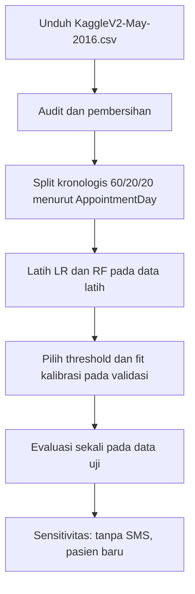

# TTKI P5: Prediksi Ketidakhadiran Pasien untuk Prioritas Pengingat

Repositori ini memuat kode untuk proyek akhir Tata Tulis Karya Ilmiah (PENS, semester 5, 2026), topik P5.

**Research question:** Apakah optimasi threshold dan kalibrasi probabilitas meningkatkan kualitas prioritisasi pasien berisiko no-show pada kapasitas pengingat 10%?

**Status:** kode dan hasil eksperimen lengkap. Semua angka di `results/`, `results_no_sms/`, dan `results_unseen/` berasal dari run penulis pada `KaggleV2-May-2016.csv` dan sudah dijalankan ulang di laptop penulis dengan selisih 0,0 terhadap hasil awal. Untuk mengulang, unduh CSV sendiri (lihat `data/README.md`) dan ikuti urutan di bawah.

## Sumber data dan atribusi

- Dataset: Medical Appointment No Shows, Kaggle, <https://www.kaggle.com/datasets/joniarroba/noshowappointments>
- Berkas yang dipakai: `KaggleV2-May-2016.csv` (110.527 baris, 14 kolom), SHA-256 `9132d3e7d0246617df9041d3764f20ad6f08e7b0d9f0997fa254fc5e52eda27d`.
- Lisensi: CC BY-NC-SA 4.0, <https://creativecommons.org/licenses/by-nc-sa/4.0/> (lisensi dikonfirmasi pada halaman Kaggle, 19 November 2026). Tanggal unduh: 19 November 2026 (berkas KaggleV2-May-2016.csv, SHA-256 pada butir sebelumnya). Halaman Kaggle tidak menampilkan nomor versi pada bagian yang diperiksa, jadi berkas diidentifikasi lewat SHA-256. Pemilik di Kaggle: joniarroba; deskripsi dataset menyebut Joni Hoppen dan Aquarela Analytics sebagai rujukan.
- Repositori referensi baseline: <https://github.com/Rachel-Oyeyemi/Medical-Appointment-No-Shows> (memakai data sintetis; tidak ada angka dari repositori itu yang dipakai di sini).
- Berkas CSV tidak dikomit. Unduh sendiri dari Kaggle dan taruh di `data/` (lihat `data/README.md`).

## Environment

```bash
python -m venv .venv
# Windows: .venv\Scripts\activate
# Linux/macOS: source .venv/bin/activate
pip install -r requirements.txt
python -m pip freeze > environment-freeze.txt
```

Dibutuhkan scikit-learn 1.6 atau lebih baru (memakai `FrozenEstimator`). Versi yang dipakai tiap run dicatat otomatis di `results/run_config.json`.

Run yang dilaporkan di paper: Python 3.13.18, scikit-learn 1.9.1, pandas 3.0.5, numpy 2.5.3 (Linux). Penulis menjalankan ulang di laptop Windows dan memperoleh angka yang sama (selisih 0,0). Daftar paket lengkap ada di `environment-freeze.txt`.

## Urutan menjalankan

```bash
# 1. Audit dataset (catat hasilnya di bagian Methods)
python src/audit_dataset.py --data data/<nama-file>.csv

# 2. Eksperimen utama: baseline, skenario A, B, C
python src/run_experiments.py --data data/<nama-file>.csv --out results --figures figures

# 3. Sensitivitas (opsional, dilaporkan sebagai analisis tambahan)
python src/run_experiments.py --data data/<nama-file>.csv --out results_no_sms --figures figures_no_sms --exclude-sms
python src/run_experiments.py --data data/<nama-file>.csv --out results_unseen --figures figures_unseen --unseen-patients

# 4. Confusion matrix (Tabel 3 di paper; LR dan RF seed 0)
python src/confusion_matrices.py --data data/<nama-file>.csv --out results
```

Alur kerja proyek:



## Rancangan eksperimen

| Komponen | Rancangan |
| --- | --- |
| Unit observasi | Satu janji temu (`AppointmentID`) |
| Target | `No-show` (Yes = 1) |
| Fitur | Usia, jarak hari jadwal ke janji (`lead_days`), jam dan hari penjadwalan, hari janji, jenis kelamin, beasiswa, hipertensi, diabetes, alkoholisme, handicap, `SMS_received`, lingkungan (one-hot, kategori jarang digabung) |
| Fitur terlarang | `PatientId`, `AppointmentID` (identitas, tidak dipakai sebagai fitur) |
| Split | Kronologis menurut `AppointmentDay`: 60% train, 20% validation, 20% test (satu hari penuh selalu di satu bagian) |
| Kebocoran | Scaler dan encoder di-fit hanya pada train (Pipeline). Test tidak dipakai untuk tuning apa pun |
| Seed | Random Forest dijalankan dengan seed 0 sampai 4; Logistic Regression deterministik |

Skenario:

- **baseline**: Logistic Regression dan Random Forest, threshold 0,5.
- **A**: threshold dipilih pada validation set dengan kriteria F1 maksimum, lalu diterapkan ke test.
- **A2** (eksploratif, ditambahkan setelah run pertama): threshold sama dengan persentil ke-90 skor validation, sehingga kira-kira 10% janji temu ditandai tanpa melihat test. Laporkan sebagai analisis tambahan.
- **B**: probabilitas dikalibrasi (sigmoid dan isotonic) pada validation set yang terpisah dari train dan test.
- **C**: capaian pada kapasitas 10% teratas (precision@10%, recall@10%, lift) untuk semua skor, dibandingkan dengan pemilihan acak dan heuristik `lead_days`.

Metrik: PR-AUC, ROC-AUC, precision@10%, recall@10%, lift@10%, Brier score, ECE, serta precision/recall/F1 pada threshold. Interval kepercayaan 95% (bootstrap baris, seed 0) ada di `results/bootstrap_ci.csv`.

## Keluaran

| Berkas | Isi |
| --- | --- |
| `results/audit.json` | Ringkasan audit dan jumlah baris yang dibuang |
| `results/dataset_characteristics.csv` | Ukuran, rentang tanggal, no-show rate, dan tumpang tindih pasien per split |
| `results/metrics.csv` | Metrik per skenario, model, dan seed |
| `results/summary.csv` | Rata-rata dan simpangan baku antar seed |
| `results/bootstrap_ci.csv` | Interval kepercayaan bootstrap |
| `results/confusion_matrices.csv` | TP, FP, FN, TN per skenario (LR dan RF seed 0) |
| `results/run_config.json` | Argumen, versi paket, hash SHA-256 data |
| `figures/` | Kurva PR, reliability diagram, precision@k |

Angka utama yang seharusnya muncul di `results/summary.csv` (data uji, kapasitas 10%): precision@10% Random Forest 0,369, Logistic Regression 0,339, heuristik `lead_days` 0,318, acak 0,181. Kalau hasilmu berbeda, periksa SHA-256 berkas data dan versi paket.

## Paper

Naskah paper disimpan di `paper/` setelah dipindahkan ke template dosen. Matriks literatur ada di `references/literature_matrix.csv`, log penelusuran gap di `references/gap_search_log.csv`.

## Keterbatasan yang perlu dilaporkan

- Satu pasien bisa muncul di beberapa split pada split kronologis; tumpang tindihnya tercatat di `dataset_characteristics.csv`, dan sensitivitas `--unseen-patients` menguji dampaknya.
- `SMS_received` bersifat observasional. Jangan menyimpulkan efek kausal SMS terhadap kehadiran.
- Data berasal dari satu kota dan satu periode; generalisasi terbatas.

## Pengujian kode

`tests/make_synthetic_smoke_data.py` membuat data tiruan hanya untuk memastikan kode berjalan. Hasil dari data tiruan tidak boleh dilaporkan.

```bash
python tests/make_synthetic_smoke_data.py /tmp/synthetic_smoke.csv
python src/run_experiments.py --data /tmp/synthetic_smoke.csv --out /tmp/smoke_out --figures /tmp/smoke_fig --seeds 2 --n-boot 50
```

## Lisensi

Kode di repositori ini berlisensi MIT (lihat `LICENSE`). Lisensi itu hanya berlaku untuk kode; dataset Kaggle tetap berlisensi CC BY-NC-SA 4.0 dan tidak didistribusikan di sini.

## Integritas akademik

Tidak ada token Kaggle, kata sandi, atau data privat di repositori ini.

Penggunaan AI: Claude (Anthropic) dipakai untuk membantu menyusun kode eksperimen, analisis, dan draf tulisan. Seluruh hasil dijalankan ulang oleh penulis dan dicocokkan dengan keluaran yang dilaporkan; penulis bertanggung jawab atas isi repositori dan paper.
